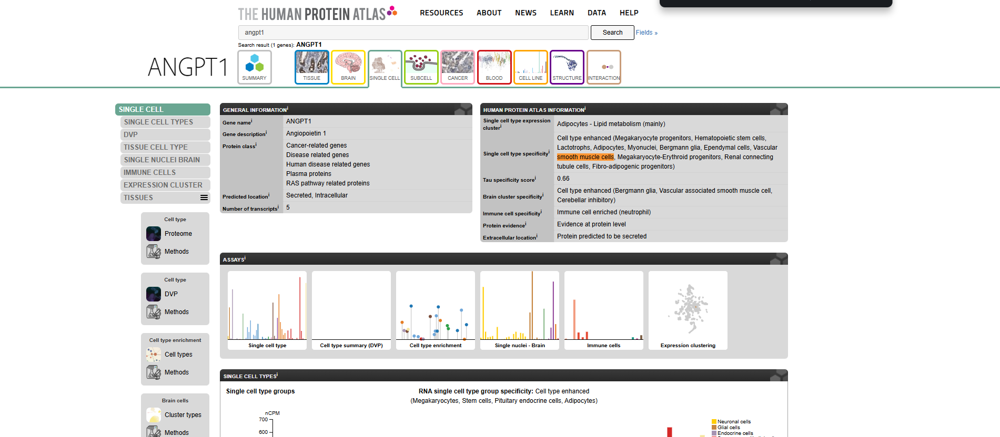
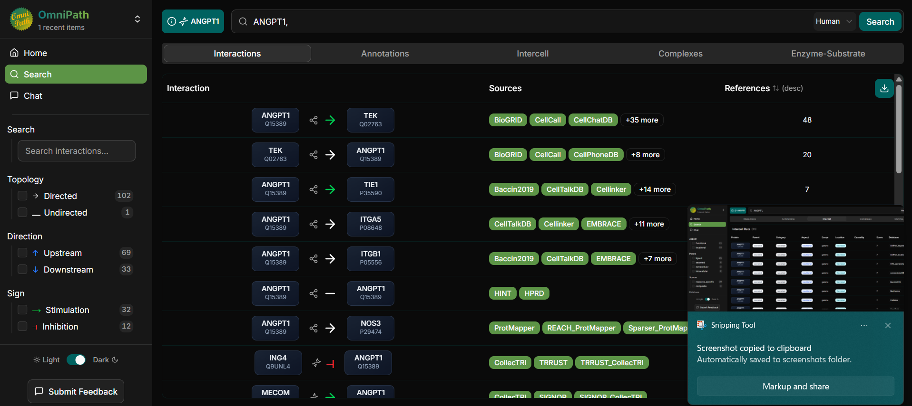
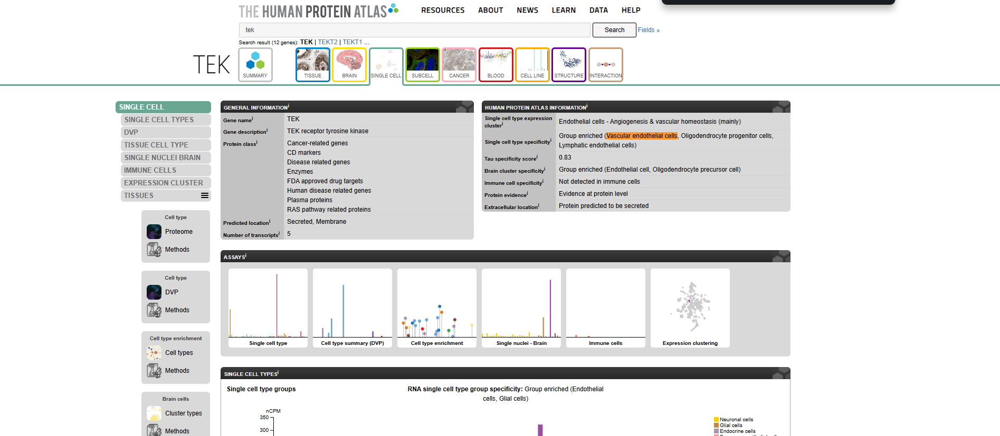
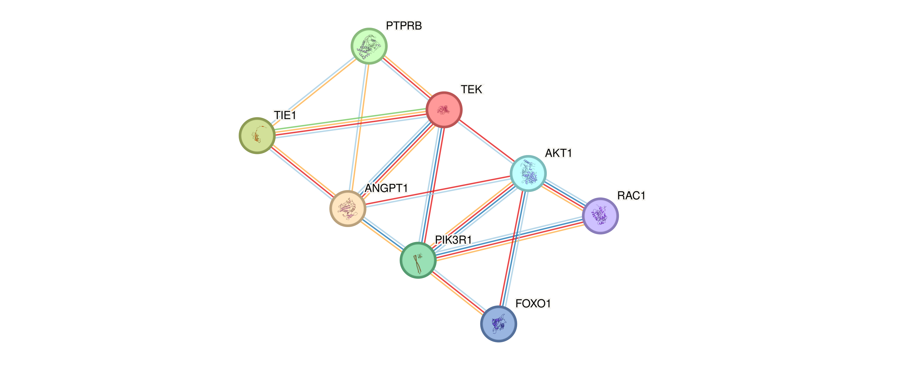
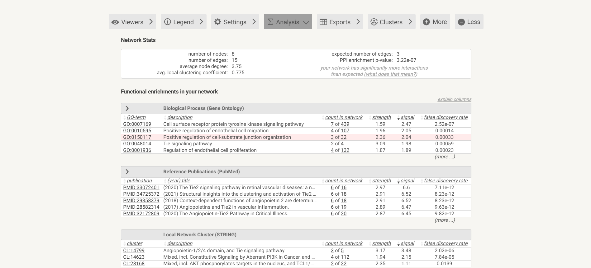
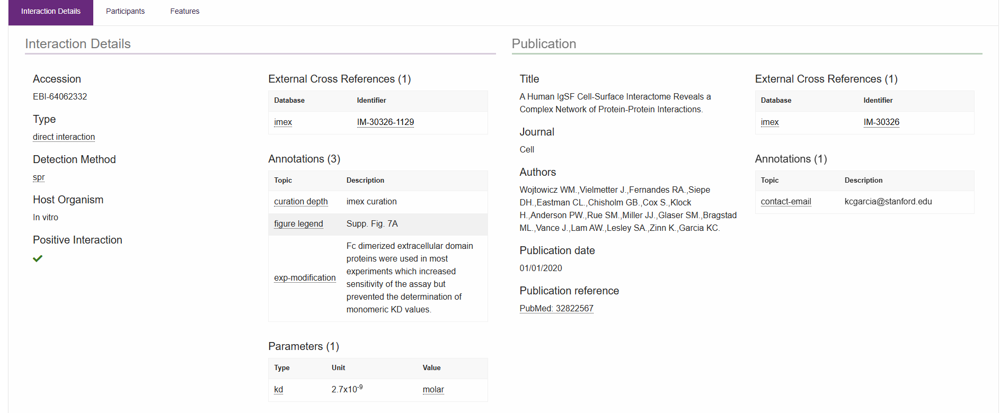
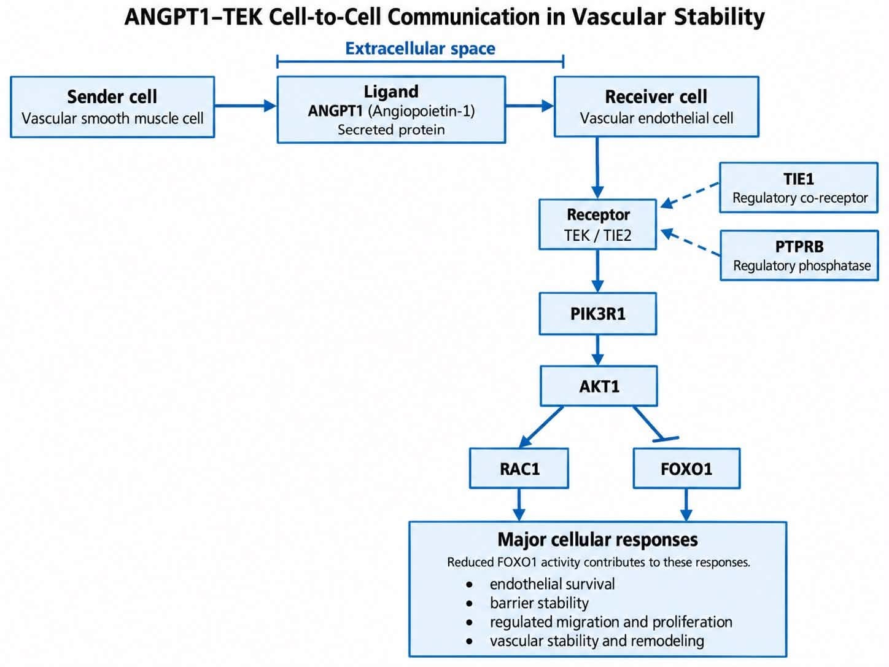

# ANGPT1–TEK-Mediated Cell-to-Cell Communication in Vascular Stability

**Laboratory Activity:** Individual Cell-to-Cell Communication  
**Name:** Deguit, Zenas Charis C.

**Subject:** Cell and Molecular Biology Laboratory  
**Organism:** *Homo sapiens*  
**Sender Cell:** Vascular Smooth Muscle Cell  
**Biological Context:** Vascular Stability and Remodeling  

---

## 1. Introduction and Biological Question

Cell-to-cell communication is essential for coordinating cellular activities and maintaining tissue homeostasis. In the vascular system, smooth muscle cells and endothelial cells communicate through signaling molecules that regulate blood vessel development, stability, and remodeling.

This investigation focuses on the angiopoietin-1 (ANGPT1) and TEK (TIE2) signaling pathway. Using the Human Protein Atlas, OmniPath, STRING, and IntAct databases, the study examines a proposed signaling mechanism between vascular smooth muscle cells and vascular endothelial cells.

### Biological Question

How does angiopoietin-1 (ANGPT1) produced by vascular smooth muscle cells communicate with vascular endothelial cells through the TEK receptor, and what intracellular signaling proteins contribute to vascular stability and remodeling?

### Objectives

1. Identify a signaling molecule associated with the selected sender cell.
2. Determine a biologically appropriate receptor and receiver cell.
3. Examine relevant intercellular signaling annotations using OmniPath.
4. Analyze receptor-associated proteins and functional enrichment using STRING.
5. Investigate experimental evidence of a molecular interaction using IntAct.
6. Construct an evidence-based model of cell-to-cell communication.

---

## 2. Part A: Sender Cell and Biological Context

### Selected Sender Cell

**Vascular Smooth Muscle Cell (VSMC)**

Vascular smooth muscle cells are specialized cells located primarily in the tunica media of blood vessels. They regulate vascular tone through contraction and relaxation and participate in maintaining blood vessel structure.

These cells also contribute to vascular remodeling and repair by communicating with neighboring cells through signaling molecules.

### Biological Context

**Vascular Stability and Remodeling**

Vascular smooth muscle cells participate in vascular maintenance by producing signaling molecules that influence neighboring endothelial cells. This communication is important for endothelial survival, barrier integrity, and blood vessel stability.

The proposed signaling system was investigated using human vascular smooth muscle cells as the sender cells.

---

## 3. Part B: Identification of the Candidate Signaling Molecule

### Selected Ligand

| Information | Description |
|---|---|
| Gene Symbol | ANGPT1 |
| Protein Name | Angiopoietin-1 |
| UniProt ID | Q15389 |
| Sender Cell | Vascular Smooth Muscle Cell |
| Protein Classification | Secreted signaling protein |
| Proposed Signaling Type | Paracrine |

### Human Protein Atlas Findings

The Human Protein Atlas identified ANGPT1 as a gene exhibiting cell-type-enhanced RNA expression in vascular smooth muscle cells.

The database reported the following:

- **Single cell type specificity:** Cell type enhanced
- **Relevant cell type:** Vascular smooth muscle cells
- **Protein evidence:** Evidence at protein level
- **Extracellular location:** Protein predicted to be secreted

These findings support the selection of ANGPT1 as a candidate signaling molecule associated with vascular smooth muscle cells.

However, enhanced RNA expression does not independently demonstrate that these cells secrete ANGPT1 under every physiological condition. Likewise, the general protein-evidence classification does not establish protein abundance specifically in vascular smooth muscle cells.

### Supporting Evidence

**Figure 1.** Human Protein Atlas evidence showing cell-type-enhanced ANGPT1 RNA expression in vascular smooth muscle cells. ANGPT1 is also classified as a protein predicted to be secreted.

**Source:** [Human Protein Atlas – ANGPT1](https://www.proteinatlas.org/ENSG00000154188-ANGPT1/single+cell)

### Classification of Cell-to-Cell Signaling

**Paracrine Signaling**

The proposed interaction represents paracrine signaling because ANGPT1 released by vascular smooth muscle cells can act on nearby vascular endothelial cells.

This local communication allows neighboring cells within the blood vessel wall to coordinate activities associated with vascular maintenance.

---

## 4. Part C: Identification of the Receptor and Receiver Cell

### OmniPath Investigation

OmniPath Explorer was used to examine the signaling roles and molecular relationships of ANGPT1.

The interaction results identified a signaling relationship between ANGPT1 and TEK.

| Component | Gene/Protein | UniProt ID |
|---|---|---|
| Ligand | ANGPT1 | Q15389 |
| Receptor | TEK (TIE2) | Q02763 |

### Intercellular Annotations

The OmniPath Intercell results provided the following information:

**ANGPT1**

- Parent category: Secreted
- Category: Secreted
- Aspect: Locational
- Location: Secreted

**TEK**

- Category: Receptor
- Aspect: Functional
- Location: Transmembrane
- Causality: Receiver

These annotations support the proposed extracellular signaling role of ANGPT1 and the receptor function of TEK.

Although the OmniPath results contain multiple annotations from different resources, TEK's established receptor function is the relevant classification for this investigation.

### Supporting OmniPath Evidence

**Figure 2.** OmniPath Explorer results identifying an ANGPT1–TEK signaling interaction. The database provides evidence supporting the ligand–receptor relationship investigated in this activity.

**Source:** [OmniPath Explorer](https://explore.omnipathdb.org/)

### Selected Receiver Cell

**Vascular Endothelial Cell**

Vascular endothelial cells line the inner surface of blood vessels and are involved in vascular permeability, blood vessel development, and maintenance of endothelial integrity.

The Human Protein Atlas identified TEK expression in vascular endothelial cells.

| Information | Findings |
|---|---|
| Receptor Gene | TEK |
| Protein Name | TEK receptor tyrosine kinase (TIE2) |
| Receiver Cell | Vascular Endothelial Cell |
| Single Cell Type Specificity | Group enriched |
| Expression Cluster | Endothelial cells – Angiogenesis & vascular homeostasis |
| Protein Evidence | Evidence at protein level |

The group-enriched cell types included vascular endothelial cells, lymphatic endothelial cells, and oligodendrocyte progenitor cells.

These findings support vascular endothelial cells as biologically reasonable receivers of ANGPT1 signaling through TEK.

### Receiver Cell Evidence

**Supporting evidence.** Human Protein Atlas results showing group-enriched TEK RNA expression in vascular endothelial cells.

**Source:** [Human Protein Atlas – TEK](https://www.proteinatlas.org/ENSG00000120156-TEK/single+cell)

### Proposed Communication Mechanism

Vascular smooth muscle cells express angiopoietin-1 (ANGPT1), which can signal through the TEK (TIE2) receptor on neighboring vascular endothelial cells in the context of vascular stability and remodeling.

This proposed mechanism is supported by cell-type expression evidence and established ligand–receptor information, although signaling between the selected cells was not directly measured in this investigation.

---

## 5. Part D: Receptor-Centered Protein Network Analysis Using STRING

### STRING Network Construction

A receptor-centered protein-association network was generated using STRING version 12.5.

The analysis used *Homo sapiens* and included the selected receptor, ligand, and additional signaling proteins.

The network consisted of the following eight proteins:

| Protein | Biological Function |
|---|---|
| TEK | Receptor tyrosine kinase activated by angiopoietin signaling |
| ANGPT1 | Extracellular ligand involved in vascular stability |
| TIE1 | Receptor-associated regulator of angiopoietin signaling |
| PTPRB | Protein tyrosine phosphatase involved in endothelial receptor regulation |
| PIK3R1 | Regulatory subunit involved in PI3K signaling |
| AKT1 | Intracellular kinase involved in cell survival and signaling regulation |
| FOXO1 | Transcription factor regulated through AKT-associated signaling |
| RAC1 | Small GTPase involved in cytoskeletal organization and endothelial junction regulation |

### STRING Network Visualization

**Figure 3.** STRING protein-association network centered on TEK and ANGPT1, showing eight proteins associated with the proposed vascular signaling mechanism. Network edges represent functional protein associations and do not necessarily indicate direct physical interactions.

### Network Statistics

| Network Parameter | Result |
|---|---|
| Number of Nodes | 8 |
| Number of Edges | 15 |
| Expected Number of Edges | 3 |
| Average Node Degree | 3.75 |
| Average Local Clustering Coefficient | 0.775 |
| PPI Enrichment p-value | 3.22 × 10⁻⁷ |

### Network Interpretation

The STRING network contained eight proteins connected by 15 associations, compared with three expected edges.

The PPI enrichment p-value of 3.22 × 10⁻⁷ indicates that the selected proteins have significantly more associations than expected for a random group of proteins of similar size.

This finding supports the functional relatedness of the selected proteins.

However, STRING associations do not automatically establish direct binding, reaction order, or causal signaling direction.

### Functional Enrichment Analysis

STRING identified several enriched biological processes relevant to the proposed ANGPT1–TEK signaling mechanism.

| GO ID | Biological Process | False Discovery Rate |
|---|---|---|
| GO:0007169 | Cell surface receptor protein tyrosine kinase signaling pathway | 2.52 × 10⁻⁷ |
| GO:0010595 | Positive regulation of endothelial cell migration | 0.00014 |
| GO:0150117 | Positive regulation of cell-substrate junction organization | 0.00033 |
| GO:0048014 | Tie signaling pathway | 0.00059 |
| GO:0001936 | Regulation of endothelial cell proliferation | 0.00023 |

### Selected Enriched Biological Process

**Tie Signaling Pathway (GO:0048014)**

The Tie signaling pathway was selected as the most directly relevant enriched process because TEK (TIE2) is the receptor involved in the proposed ANGPT1-mediated communication system.

The pathway had a false discovery rate of **0.00059**, supporting its significant enrichment among the analyzed proteins.

This finding is consistent with the involvement of angiopoietin receptor signaling in vascular endothelial function.

### Functional Enrichment Evidence

**Supporting evidence.** STRING network statistics and Gene Ontology biological process enrichment results, including the Tie signaling pathway.

### Relevant Intracellular Proteins

Four intracellular proteins were selected to explain the proposed receptor-associated cellular response.

**1. PIK3R1**

PIK3R1 encodes a regulatory subunit of phosphoinositide 3-kinase (PI3K). PI3K signaling participates in transmitting signals from activated cell-surface receptors to intracellular effectors.

**2. AKT1**

AKT1 is a serine/threonine kinase involved in cellular survival and signaling regulation. Activation of the PI3K–AKT pathway contributes to endothelial survival and vascular stability.

**3. FOXO1**

FOXO1 is a transcription factor involved in regulating genes associated with cell survival, growth, and vascular functions. AKT-mediated phosphorylation can inhibit FOXO1 activity, influencing endothelial gene expression.

**4. RAC1**

RAC1 is a small GTPase that regulates actin cytoskeletal organization and cell junction stability. Its activity contributes to endothelial barrier regulation.

Together, these proteins provide a biologically plausible explanation for the cellular responses associated with ANGPT1–TEK signaling.

The proposed signaling relationships are supported by published pathway studies, while STRING independently supports the functional association of the selected proteins.

**Sources:**
- [STRING Database](https://string-db.org/)
- [Eklund et al. – Angiopoietin–Tie Signalling](https://pmc.ncbi.nlm.nih.gov/articles/PMC5146956/)

---

## 6. Part E: Molecular Interaction Validation Using IntAct

### Selected Molecular Interaction

The ANGPT1–TEK protein pair was examined using the IntAct Molecular Interaction Database.

The database provided an experimentally supported interaction record involving human ANGPT1 and TEK.

### IntAct Interaction Record

| Information | Finding |
|---|---|
| Interaction ID | EBI-64062332 |
| Molecule A | ANGPT1 |
| Molecule B | TEK |
| UniProt IDs | Q15389 and Q02763 |
| Protein Species | *Homo sapiens* |
| Interaction Type | Direct interaction |
| Detection Method | Surface plasmon resonance (SPR) |
| Experimental Condition / Host | In vitro |
| Publication | Wojtowicz et al. (2020) |
| PubMed ID | 32822567 |

### Experimental Evidence

The interaction was supported by surface plasmon resonance (SPR), a method used to investigate molecular binding interactions.

The IntAct record classified the ANGPT1–TEK relationship as a direct interaction under in vitro experimental conditions.

This provides evidence supporting the physical interaction between the selected ligand and receptor.

The experimental evidence was associated with the publication *A Human IgSF Cell-Surface Interactome Reveals a Complex Network of Protein-Protein Interactions* by Wojtowicz et al. (2020).

### IntAct Evidence

**Figure 4.** IntAct interaction record EBI-64062332 showing an experimentally reported direct interaction between ANGPT1 and TEK, detected using surface plasmon resonance under in vitro conditions.

### Interpretation

The IntAct evidence supports a direct molecular interaction between ANGPT1 and TEK.

Unlike the functional associations identified through STRING, this record specifically reports an experimentally examined interaction.

However, the experiment does not independently demonstrate that ANGPT1 produced by vascular smooth muscle cells binds TEK on neighboring endothelial cells in living vascular tissue.

Therefore, the ligand–receptor relationship is experimentally supported, while its occurrence between the selected sender and receiver cells remains a biologically plausible interpretation.

**Sources:**
- [IntAct Interaction Record EBI-64062332](https://www.ebi.ac.uk/intact/details/interaction/EBI-64062332)
- [Wojtowicz et al. (2020), PubMed](https://pubmed.ncbi.nlm.nih.gov/32822567/)

---

## 7. Part F: Final Cell-to-Cell Communication Model

### Proposed ANGPT1–TEK Signaling Mechanism

**Figure 5.** Proposed ANGPT1–TEK-mediated cell-to-cell communication between vascular smooth muscle cells and vascular endothelial cells. The diagram illustrates the extracellular ligand–receptor interaction, receptor-associated regulatory proteins, selected intracellular signaling components, and expected cellular responses contributing to vascular stability.

### Final Model Interpretation

The proposed model illustrates paracrine communication between vascular smooth muscle cells and vascular endothelial cells through the ANGPT1–TEK signaling pathway. The Human Protein Atlas identifies ANGPT1 RNA as cell-type enhanced in vascular smooth muscle cells and predicts that the encoded protein is secreted. It also reports enriched TEK expression in vascular endothelial cells, supporting the biological plausibility of the sender–receiver pair.

Following release into the extracellular space, angiopoietin-1 (ANGPT1) can bind the endothelial TEK (TIE2) receptor. OmniPath records an ANGPT1–TEK signaling interaction and annotates ANGPT1 as secreted and TEK as a receptor. IntAct further documents an ANGPT1–TEK direct interaction measured by surface plasmon resonance under in vitro conditions (Wojtowicz et al., 2020).

The proposed downstream mechanism involves PIK3R1 and AKT1, with RAC1 contributing to cytoskeletal and junction regulation and AKT1-mediated inhibition of FOXO1 affecting transcriptional responses. TIE1 and PTPRB are included as receptor-associated regulators. The STRING network contained eight proteins and showed enrichment of the Tie signaling pathway (GO:0048014; FDR = 0.00059). Collectively, these findings are consistent with endothelial survival, barrier maintenance, and vascular remodeling.

The direct ligand–receptor interaction is experimentally supported, but the exact intracellular sequence and signaling between these particular cell types remain partly inferred.

---

## 8. Questions and Answers

### 1. What sender cell did you choose, and in what tissue or biological context does it act?

The selected sender cell was the vascular smooth muscle cell, which is located primarily in the tunica media of blood vessels. These cells regulate vascular tone and contribute to blood vessel maintenance and remodeling. In this investigation, vascular smooth muscle cells were examined in the context of vascular stability, where they may communicate with neighboring endothelial cells through secreted signaling proteins.

### 2. What signaling molecule did you identify, and what evidence supports its production or presentation by the sender cell?

The identified signaling molecule was angiopoietin-1 (ANGPT1), a secreted protein involved in vascular regulation. The Human Protein Atlas classified ANGPT1 RNA expression as cell-type enhanced in vascular smooth muscle cells and identified the encoded protein as predicted to be secreted. These findings support ANGPT1 as a suitable candidate signaling molecule, although direct secretion by the selected cells was not experimentally demonstrated in this investigation.

### 3. What receptor receives the signal, and which receiver cell did you select?

The selected receptor was TEK, also known as TIE2, a receptor tyrosine kinase that recognizes angiopoietin-1. The selected receiver cell was the vascular endothelial cell. OmniPath identified an ANGPT1–TEK interaction and classified TEK as a receptor, while the Human Protein Atlas showed group-enriched TEK expression in vascular endothelial cells.

### 4. What type of cell-to-cell signaling is represented: paracrine, endocrine, autocrine, or contact-dependent?

The proposed communication represents paracrine signaling. In this mechanism, ANGPT1 is released by vascular smooth muscle cells and acts on nearby vascular endothelial cells through the TEK receptor. Because the proposed interaction occurs locally between neighboring cells, it is classified as paracrine rather than endocrine, autocrine, or contact-dependent signaling.

### 5. Which proteins in your STRING network appear most relevant to the receptor-associated response? Explain briefly.

The four selected intracellular proteins were PIK3R1, AKT1, FOXO1, and RAC1. PIK3R1 participates in PI3K-associated signal transduction, while AKT1 regulates signaling associated with endothelial survival. FOXO1 influences transcriptional responses and can be inhibited through AKT signaling. RAC1 regulates cytoskeletal organization and endothelial junction stability. Together, these proteins are relevant to the proposed cellular responses associated with TEK activation.

### 6. What enriched pathway or biological process is consistent with your proposed mechanism?

The Tie signaling pathway (GO:0048014) was identified as a relevant enriched biological process, with a false discovery rate of 0.00059. This pathway is consistent with the proposed mechanism because ANGPT1 signals through TEK (TIE2), which participates in regulating endothelial survival, vascular integrity, and remodeling.

### 7. What did IntAct show for the molecular interaction you examined? What type of evidence was reported?

IntAct identified a direct interaction between ANGPT1 and TEK under interaction record EBI-64062332. The interaction was examined using surface plasmon resonance (SPR) under in vitro conditions and was associated with Wojtowicz et al. (2020). The record provides experimental evidence supporting direct molecular binding between the selected ligand and receptor.

### 8. Which parts of your final model are strongly supported, and which parts remain an inference?

The model is supported by Human Protein Atlas evidence for ANGPT1 RNA expression in vascular smooth muscle cells and TEK expression in vascular endothelial cells. OmniPath supports the ligand–receptor relationship, while IntAct provides experimental evidence of direct ANGPT1–TEK binding. STRING identifies relevant functional protein associations and enriched biological processes. However, the complete intracellular signaling sequence and the occurrence of this interaction specifically between the selected cell types under physiological conditions remain partly inferred.

### 9. What cellular response is expected in the receiver cell, and why?

The expected responses include increased endothelial survival, improved barrier stability, regulation of cell migration and proliferation, and maintenance of vascular integrity. These responses are consistent with ANGPT1–TEK signaling through intracellular pathways involving PI3K–AKT, FOXO1, and RAC1. Such signaling can help endothelial cells maintain their junctions and contribute to blood vessel stability and remodeling.

---

## 9. Summary of Evidence

| Component | Evidence Source | Main Finding |
|---|---|---|
| Sender Cell | Human Protein Atlas | ANGPT1 RNA expression is cell-type enhanced in vascular smooth muscle cells |
| Ligand | Human Protein Atlas | ANGPT1 encodes a protein predicted to be secreted |
| Ligand–Receptor Relationship | OmniPath | ANGPT1–TEK signaling interaction identified |
| Receptor | OmniPath | TEK classified as a receptor |
| Receiver Cell | Human Protein Atlas | TEK RNA expression is group enriched in vascular endothelial cells |
| Intracellular Proteins | STRING | Functionally associated proteins identified |
| Enriched Process | STRING | Tie signaling pathway (GO:0048014; FDR = 0.00059) |
| Experimental Interaction | IntAct | Direct ANGPT1–TEK interaction supported by SPR |
| Final Model | Integrated Evidence | Proposed paracrine signaling mechanism associated with endothelial stability |

---

## 10. Conclusion

The investigation identified a biologically plausible cell-to-cell communication mechanism involving ANGPT1 signaling from vascular smooth muscle cells to TEK-expressing vascular endothelial cells. Human Protein Atlas findings supported the selected cell types, while OmniPath provided relevant signaling annotations. STRING analysis identified functionally associated proteins and enrichment of the Tie signaling pathway, and IntAct provided experimental evidence of a direct ANGPT1–TEK interaction.

The integrated findings support a proposed paracrine signaling mechanism associated with endothelial survival, barrier integrity, and vascular remodeling. Nevertheless, the exact intracellular signaling sequence and its occurrence between the selected cells require additional experimental verification.

---

## 11. References

Eklund, L., Kangas, J., & Saharinen, P. (2017). Angiopoietin–Tie signalling in the cardiovascular and lymphatic systems. *Clinical Science, 131*(1), 87–103. https://portlandpress.com/clinsci/article/131/1/87/71594/Angiopoietin-Tie-signalling-in-the-cardiovascular

Human Protein Atlas. (n.d.). *ANGPT1: Single cell type expression*. https://www.proteinatlas.org/ENSG00000154188-ANGPT1/single+cell

Human Protein Atlas. (n.d.). *TEK: Single cell type expression*. https://www.proteinatlas.org/ENSG00000120156-TEK/single+cell

IntAct Molecular Interaction Database. (n.d.). *Interaction record EBI-64062332*. European Bioinformatics Institute. https://www.ebi.ac.uk/intact/details/interaction/EBI-64062332

OmniPath. (n.d.). *OmniPath Explorer: Integrated signaling and intercellular communication resources*. https://explore.omnipathdb.org/

STRING. (n.d.). *STRING: Protein association networks and functional enrichment*. https://string-db.org/

Wojtowicz, W. M., et al. (2020). A human IgSF cell-surface interactome reveals a complex network of protein-protein interactions. *Cell, 182*(4), 1027–1043.e17. https://www.cell.com/cell/fulltext/S0092-8674(20)30933-8?_returnURL=https%3A%2F%2Flinkinghub.elsevier.com%2Fretrieve%2Fpii%2FS0092867420309338%3Fshowall%3Dtrue

---

## 12. Database Resources

- [Human Protein Atlas](https://www.proteinatlas.org/)
- [OmniPath Explorer](https://explore.omnipathdb.org/)
- [STRING Database](https://string-db.org/)
- [IntAct Molecular Interaction Database](https://www.ebi.ac.uk/intact/)
- [UniProt](https://www.uniprot.org/)

---

**Laboratory Documentation:** Individual Cell-to-Cell Communication  
**Selected Signaling System:** Vascular Smooth Muscle Cell → ANGPT1 → TEK (TIE2) → Vascular Endothelial Cell  
**Biological Context:** Vascular Stability and Remodeling
